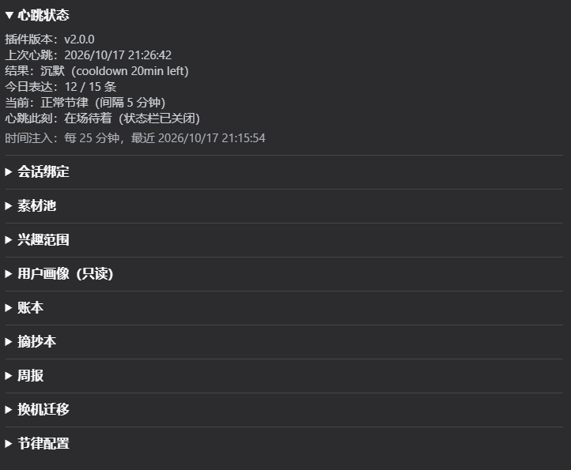
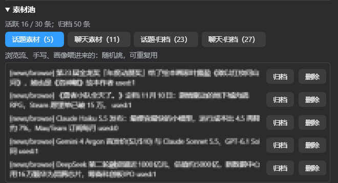
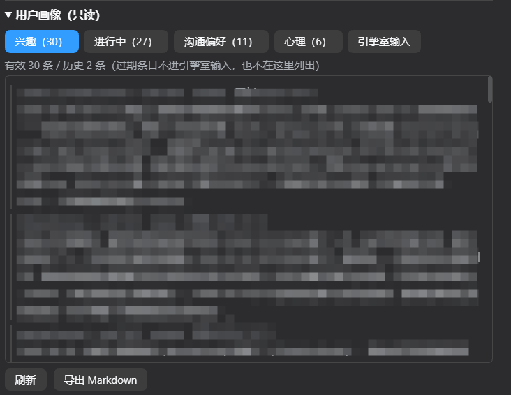
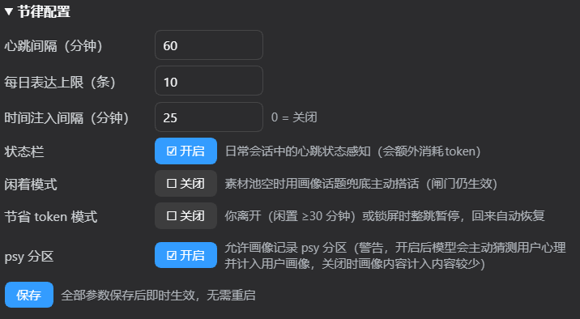
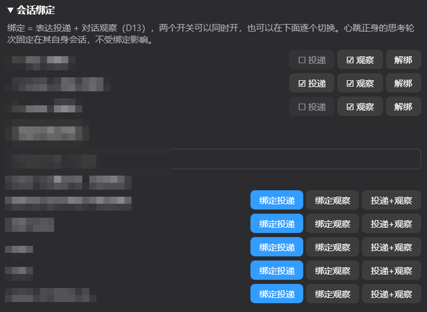
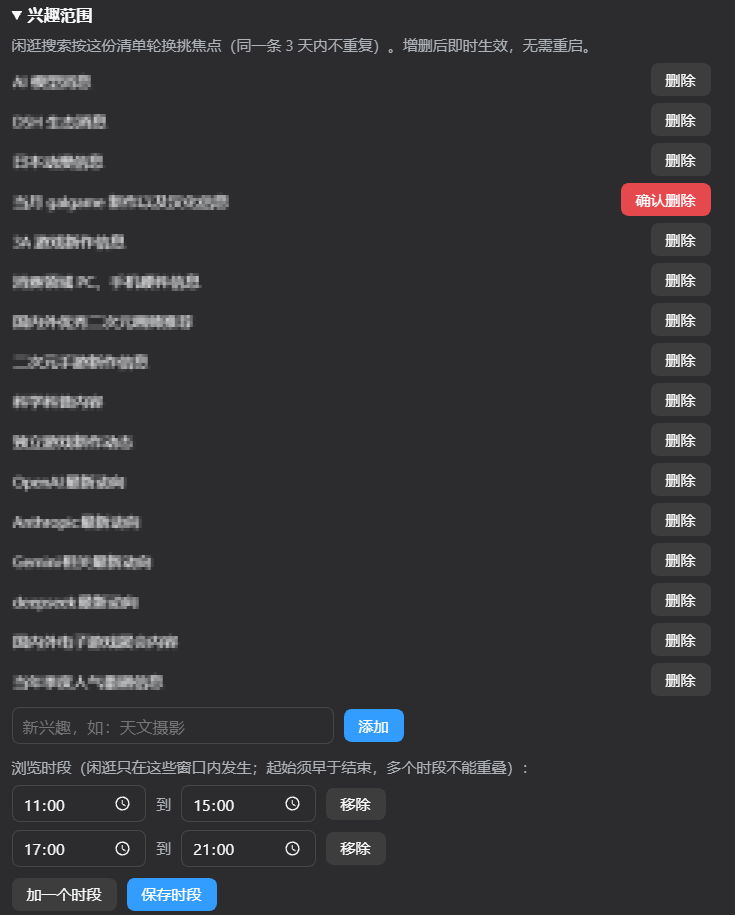
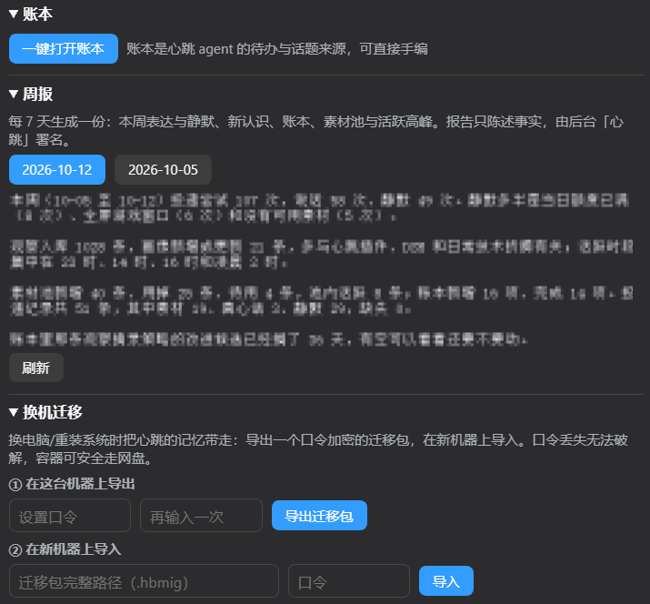

# dsh-heartbeat

> 让 DeepSeek Harness 的 agent 拥有持续存在感的心跳插件：她按节律自己醒来，维护记忆与画像、感知你的忙闲、按兴趣闲逛看新东西，然后**按分寸决定开不开口**——开口要有真实来处，沉默要有具体理由。

[](https://github.com/deepseek-ai/deepseek-harness)
[](https://www.npmjs.com/package/@kanadego/dsh-heartbeat)
[](https://www.npmjs.com/package/@kanadego/dsh-heartbeat)
[]()
[]()

---

## 一分钟了解

全部能力都收在 DSH 设置页的**心跳卡片**里，日常使用零命令行：

| 设置卡总览                              | 素材池                               |
| --------------------------------------- | ------------------------------------ |
|  |  |

| 用户画像（只读）                       | 节律配置                              |
| -------------------------------------- | ------------------------------------- |
|  |  |

<details>
<summary><b>展开看其余分区：会话绑定 / 兴趣范围 / 账本 · 周报 · 换机迁移</b></summary>

| 会话绑定                                | 兴趣范围                                 |
| --------------------------------------- | ---------------------------------------- |
|  |  |

| 账本 · 周报 · 换机迁移                       |
| -------------------------------------------- |
|  |

</details>

> 截图为 v1.9.3；画像与会话绑定两张里的条目文字已打码。

**它想解决的三件事**：

| 你想要的             | 插件怎么给                                                                                                 |
| -------------------- | ---------------------------------------------------------------------------------------------------------- |
| 零命令行             | 绑定会话、节律、素材池、画像、账本、迁移全在设置卡里；CLI 只留给脚本场景                                   |
| 不打扰、不烧 token   | 静默时段 / 忙时窗口 / 每日上限 / 开口冷却 / 在场联动全是代码层判定——判「别说」时，之后的**决策与表达**两相根本不调用模型（闲逛相在闸门之前触发，另算） |
| 像活人，不像定时播报 | 素材分话题与聊天两仓，反刍成一句话再投递；说不说、说哪条，由你那个会话里的 agent 按当下处境拍板            |

## 快速开始

### 安装（npm 包，推荐）

```powershell
dsh plugin --profile web add @kanadego/dsh-heartbeat
```

重启 DSH 即生效——插件自动创建专用心跳会话并按节律运行，之后日常无需任何操作。

**心跳预设是自动装的**：插件加载时直接向宿主注册（`agentPresets.register()`，v1.9.2 起），不需要任何手动操作，**安装清单里也不再声明宿主包**。缺失就按包内模板建好，**已有文件永不覆写**（你手改过的预设原样保留）。无论走哪条路径，没有这个预设心跳 agent 就是个"裸 agent"，连 `web_search` 都看不见——想手动检查/修复用 `preset status` / `preset install`（见下节）；把插件 config 的 `installPreset` 设为 `false` 可同时关掉运行时注册与目录自装，预设完全由你管。

### 从源码安装（开发/改造用）

```powershell
dsh plugin --profile web add file:D:/path/to/dsh-heartbeat
```

### 数据放在哪

数据默认住在**包外**：`<DSH_HOME>/heartbeat-data`（没有 `DSH_HOME` 就是 `~/.dsh/heartbeat-data`），重装与升级都不会碰它。老版本装在包目录里的 `data/` 会在首次启动时自动搬过去（搬迁前先备份、逐文件校验通过才删原件，见下节「卸载」）。要换位置就用插件 config 的 `dataDir`，或环境变量 `HEARTBEAT_DATA_DIR`。

## 核心工作机制

一跳 = agent 自己醒一次（默认 60 分钟）。醒着的时候依次走七相，最后由**留痕**收尾：

```
维护 → 采集 → 闲逛 → 闸门 → Digest → 反刍备料 → 投递 →  留痕
                        │
                   判「别说」→ 本跳到此为止，决策与表达不再调模型
```

<details>
<summary><b>点此展开：七相详情与关键概念</b></summary>

```
①  维护 ── 清素材池 / 滚动日志 / 判断该不该合并画像
②  采集 ── 全屏截图（加密落盘）+ 忙闲判定 + 前台窗口类别
           ╰─ 观察：把绑定会话里你新说的话收进画像收件箱
②′ 闲逛 ── 条件触发：agent 自己按兴趣焦点用 web_search 看新东西
③  闸门 ── 纯代码判定：静默窗 / 忙时 / 在场 / 每日上限 / 冷却
           ╰─ 判「别说」→ 本跳到此为止，决策与表达不再调模型
④  Digest ── 拼出「此刻状态」：画像 + 时间 + 素材池 + 待办
⑤  反刍 ── 引擎室从素材池挑 ≤3 条，各压成一句话（备料）
⑥  投递 ── 拼成素材包，送进你指定投递的那个会话
⑦  留痕 ── 写审计日志 + 账本（真正开口了才计数）
  │
  ▼
你读的那个会话 ── 那里的 agent 按当下处境，决定说不说、说哪条
```

文档里反复出现几个词，在这里一次说清：

| 词           | 意思                                                                                                                                                                                                                                |
| ------------ | ----------------------------------------------------------------------------------------------------------------------------------------------------------------------------------------------------------------------------------- |
| **心跳**     | 本插件的核心动作——不用你开口，agent 按固定节律自己「醒一次」：做维护、感知环境、决定要不要说话。醒一次叫**一跳**，默认 60 分钟一跳。                                                                                                |
| **宿主**     | 运行插件的那个程序，即 DSH 本体。心跳是挂在宿主里的插件——模型通道、会话、工具这些能力都由宿主提供。                                                                                                                                 |
| **客户端**   | 宿主里负责界面的那一侧（Web 界面或者 DSH desktop）。设置页的心跳卡片属于客户端；卡片显示不出来，通常是客户端插件没加载成功，与心跳本体无关。                                                                                        |
| **相**       | 一跳内部的一个阶段。主循环共七相——维护 → 采集 → 闲逛 → 闸门 → Digest → 反刍备料 → 投递，最后统一由**留痕**收尾。每相结束都会在审计日志留一条 `phase_done`，所以「这一跳停在哪」可以直接查。                                         |
| **引擎室**   | 跑心跳内部轮次的那个 agent，和你在会话里对话的 agent 是分开的。它只负责采集、反刍、备料，**不直接跟你说话**；真正开口的是你读的那个会话里的 agent。                                                                                 |
| **心跳正身** | 心跳自己专用的一个会话，同时也是它的决策现场——每跳的推理轮次都在这里发生。它在会话列表里和普通会话长得一样，日常不用去动它（CLI 的 `sessions list` 会把它单独标出来）。                                                             |
| **闸门**     | 决定「这一跳能不能开口」的纯代码判定层，依次看：静默时段 → 你是不是在忙 → 你在不在场 → 今天说够没有 → 距上次开口够久没。全不通过就安静，并在日志里写下具体原因。它也是省 token 的关键——**判「别说」时，之后的决策与表达两相根本不调用模型**（已经跑过的维护、采集、闲逛不再重来，也不因为沉默而多花）。 |
| **观察**     | 投递的反向动作——把绑定的会话里你新说的话收进**画像收件箱**，作为了解你的证据。它发生在采集相：只取当时有活 agent 的绑定会话、每跳最多 10 条、每条只留第一句（≤80 字），插件自己注入的消息会被跳过。                                 |
| **反刍**     | 投递之前的备料步骤：引擎室从素材池挑出最值得说的几条，各压缩成一句话（不带理由、不排序）。名字取自反刍动物把食物嚼细再咽。                                                                                                          |
| **投递**     | 把备好的素材包送进你某个会话的动作。把心跳绑定到常用会话，agent 就会「到你那个房间里说话」。                                                                                                                                        |

</details>

## 核心功能

### 心跳节律与分寸闸门

- **心跳节律**：定时唤醒（默认 60 分钟一跳，卡片可调），按七相循环运行——维护 → 采集 → 闲逛 → 闸门 → Digest → 反刍备料 → 投递，末了由留痕收尾。每跳都有审计留痕，沉默必带原因。
- **分寸闸门**：静默时段、忙时窗口、每日表达上限、开口冷却、在场联动，全部是代码层的独立判定，不靠模型自觉。默认倾向开口，但你正忙或已到深夜时绝不打扰。
- **状态栏与时间感知**：心跳把"此刻在干什么"（在闲逛 / 看到你在忙 / 在场待着…）注入日常会话——支持动态系统提示词的模型常驻系统提示词（KV-cache 安全追加），其余模型只在用户发起轮次时带一行。精确时间按 20–30 分钟节流注入，任务进行中绝不中途插话。

### 视觉与兴趣闲逛

- **视觉感知（可选）**：每跳对全屏截图做一次视觉识别（如果模型不支持多模态，支持经 [ModLens](https://github.com/liustack/modlens) 此类视觉辅助插件外接多模态模型），投递的素材包会带一句「（他此刻大概在：…）」；识别失败时画面与窗口标题一概不进任何提示词——隐私优先，宁可不说。
- **兴趣闲逛**：按你定义的兴趣范围轮换挑焦点（同一条 3 天冷却），用 `web_search` 看新东西（每次 3~9 轮搜索），结果由代码登记入素材池（每焦点至多 2 条，`config/interests.json` 的 `_schedule` 可调）——模型只负责搜索筛选，不做任何写盘动作。话题库存见底（≤4 条）时自动触发补货闲逛（每天至多 2 次）。

### 素材池与投递闭环

- **素材池（话题 / 聊天双仓）**：话题库存 16 条 + 聊天素材 14 条，四条确定性淘汰（TTL / 消费退休 / 冷板凳 / 容量挤出）；聊天种子来自画像合并时从对话里挑出的"值得聊的话题"，有时效性——**被说出口后至少活到下一次回收**，有新证据还会继续留池（v1.9.1 之前是"投递过 1 次即退休"，常常话刚出口上下文就断了）。归档区也有上限（默认 50 条），超出按**最老优先**裁掉；新增 / 合并 / 淘汰 / 裁剪 / 恢复 / 删除都会写进审计日志（只记编号与元数据，不记素材正文）。是缓存不是记忆，与画像单向隔离。
- **反刍投递（目标会话拍板）**：代码先凑好候选（话题随机 4 + 聊天最新 2，互补至多 6 条），引擎室挑 ≤3 条各压缩成一句，拼成素材包注入你读的会话——附一句「他此刻大概在：…」（视觉识别成功时）＋声明「这是心跳插件素材投递」＋素材清单（必要时附「也可以说一句真心话」）。说不说、说哪条，由目标会话里的 agent 按当下处境自己判断——**决定不说就把正文留空**（v1.9.3 起，但是受模型指令遵循能力限制，如想要更好的效果，建议在系统提示词/长期记忆中补充一条相应规则）；话落到你眼前的会话后，agent 会**按本次投递编号报账**——哪几条被用上、是引用素材还是顺着自己发挥，都如实记下。
- **会话绑定**：把心跳消息投递到你常用的会话（agent 会"到你房间里说话"），或观察会话内容喂养画像——投递/观察是两个独立开关，可双开。

### 记忆 · 账本 · 周报

- **用户画像**：本地结构化档案（兴趣 / 项目 / 沟通偏好 / 心理基线），带来源与置信度，稳定特质不因时间遗忘；journal 单一权威，可校验、可重建、可解密导出。
- **周报**：每 7 天一份，只报道这周干了些什么——表达与静默、新认识、账本、素材池、活跃高峰。由后台「心跳」署名写成平实中性的一句话档案，加密落盘，卡片可翻，默认只留最近 3 期（`policy.weekly.keepReports`）。
- **账本工具**：账本注册成模型工具，日常会话里的 agent 听到你提到待办/承诺会自己记账、完成后自己勾掉，不用你下命令——和心跳、CLI 记的是同一本账。
- **journal 快照基点**：画像 journal 超 5000 条自动折叠成快照 + 归档分片，重放成本有界；verify/rebuild 跨快照依然正确。

### 数据 · 迁移 · 焚毁

- **换机迁移**：一键打包画像/账本/素材池/周报为口令加密容器（卡片或 CLI），新机器导入自动用本机主密钥重加密。
- **加密与焚毁**：敏感文件 **AES-256-GCM** 整文件加密，数据密钥由 **Windows DPAPI（CurrentUser）** 保管在 `data/vault.key`，只在进程启动解一次；旧版（1.x）留下的 DPAPI 容器照样能读，`vault upgrade` 一次性改写成新格式；一键焚毁运行时数据；模型出库仅限合并裁决的最小必要摘要。

## 常见故障与诊断

第一现场永远是 `data/logs/heartbeat.jsonl`（每跳留痕，silent 必带原因）。

<details>
<summary><b>点此展开：高频报错与排错速查</b></summary>

| 症状                                                                                             | 原因与处理                                                                                                                                                                                                                                      |
| ------------------------------------------------------------------------------------------------ | ----------------------------------------------------------------------------------------------------------------------------------------------------------------------------------------------------------------------------------------------- |
| 完全没有心跳（无任何日志行）                                                                     | 插件没装入：确认 `node_modules` 里插件存在、启动无 "Failed to load plugins" 横幅；`plugin_init` 缺失 = apply 没跑                                                                                                                               |
| 一直沉默                                                                                         | 先看 `silent` 行的 reason：夜间静默窗 = 正常；白天 = cap 满 / 冷却未过 / 忙时窗口 / `token-saver`（见下条）                                                                                                                                     |
| 审计出现 `silent reason=token-saver`、心跳整跳不动                                               | **节省 token 模式**开着，且你已离开（闲置 ≥30 分钟）或锁屏——这是设计行为，不是坏了：暂停期间每 3 分钟只探一次环境（不花 token），你一回来就会恢复；绑定会话里出现新消息也算你在。不想要就关掉那个开关                                           |
| psy 分区一直空、画像只在其他分区增长                                                             | psy 开关**默认关闭**：开着时画像合并才收 psy 条目。在设置卡里打开即可                                                                                                                                                                           |
| 闲逛永远秒结束、`tool_policy` 报 `unknown global tool "web_search"`                              | 预设没挂上（裸 agent）：`preset status` → `preset install`，装好后 `tool_policy` 行应是 `preset=mounted(heartbeat) restrict=ok`                                                                                                                 |
| 设置页整块没有心跳卡片（数据照常写）                                                             | client 注册 id 与包名不一致被宿主**静默剔除**：三处必须严格等于包名，改完**重启**。若确认 id 没问题，看下一条                                                                                                                                   |
| 卡片整块消失 / 节律配置保存不了（`0.1.7` 宿主）                                                  | 旧版插件撞上 0.1.7 的接口换代（设置接口变更 + 客户端服务被删）：**升级到 v1.7.0** 并重启；v1.7.0 已按三代接口自动适配                                                                                                                           |
| 卡片分区报 `加载失败: … HTTP 405`                                                                | RPC 路由没注册成功：审计里应出现 `rpc_registered route=/api/heartbeat`，没有 = dist 未同步，重装/同步后重启                                                                                                                                     |
| 节律配置保存不生效、重启后回默认（`0.1.5` 宿主）                                                 | v1.5.x 的已知问题（dsh-settings 包缺失 + 0.1.5 API 变更）：升级到 v1.6.0 并重启；`0.1.7` 宿主的同类症状见上面「卡片整块消失」那条                                                                                                               |
| 投递没带「他此刻大概在：…」、审计有 `screen_vision ok:false`                                     | 视觉识别失败：error 字段带 ModLens 具体报错；常见为 provider 未配置或网络超时。识别失败时画面/标题按隐私设计不进提示词，心跳其余功能不受影响                                                                                                    |
| 结果显示「心跳异常（decision: whenIdle timeout）」                                               | 反刍轮超时（240s 内没等到模型回话）。v1.6.0 起不再整跳报错：记 `decision_deferred`、本跳按沉默处理、素材自动留到下一跳。若反复出现，看该行 reason 与 ModLens 画面描述是否诱发跑题                                                               |
| 每跳 `beat_error: … reading 'length'`                                                            | 宿主移除了 `Session.events`——插件版本与宿主不匹配，对照〈版本兼容〉换版本                                                                                                                                                                       |
| 引擎室轮次整轮失败、报 `format v4 message requires a producer-owned source kind`                 | `0.1.7` 的会话日志（V4）拒绝旧版通用的消息来源标记——同样是版本不匹配：升级到 v1.7.0（改用自有来源标记）                                                                                                                                         |
| 每轮报 `prompt variable "{{model}}" has no value`                                                | agent 没有模型路由（审计 `model` 字段为 `(none)`）——同样是版本不匹配症状                                                                                                                                                                        |
| 素材投递偶尔不成功、`spoke_failed: non-Chinese output discarded`                                 | 目标会话 agent 收到素材包后回合以工具调用收尾，末行是 `</tool_calls>`（纯英文）被旧判定误拦。v1.5 起已修：跳过工具收尾标签、取最后一个含中文的行；整段无中文才拒。升级后重启即可                                                                |
| 有 `spoke` 但会话里没出现这句话                                                                  | 投递目标当时没活 agent 且拉不起来：查 `deliver_target_*` 系列行；再查绑定 `deliver` 是否为 true                                                                                                                                                 |
| 素材包发了但目标没说话，想知道为什么                                                             | 查 `expression_dropped`（v1.9.1 起记录，带丢弃原因）；连续三次会在日志里补一条 `expression_dropped_streak`。v1.9.3 起「决定不说」是正常路径，不再算异常                                                                                         |
| 日志出现 `cursor_format_discarded` / `rpc_host_gate_missing` / `beat_watchdog` / `weekly_pruned` | 都是 v1.9.1 起记录的**正常自愈痕迹**（`weekly_pruned` 为 v1.9.3 新增）：分别为「旧游标格式升级丢弃、本跳全量重扫」「宿主未提供 RPC 闸门、危险端点已拒绝」「某跳超时被强制收尾」「周报超期被裁」。各出现一次不必管，反复出现再看同跳前后的其他行 |
| **侧栏某个会话行消失了**                                                                         | 心跳刚往那个"当时没打开"的会话投递过，投完释放临时 agent 的正常副作用——**刷新页面即回**，内容零损失                                                                                                                                             |
| 升级 `0.1.5` 后旧会话打不开（`unexpected member …` / `header version must be 3`）                | 会话格式 v3 迁移问题：前者用 `scripts/repair-v0-members.mjs`（预检→修复，自动备份）；后者首次访问会自动迁移，属正常                                                                                                                             |
| 升级 `0.1.7` 后会话目录里多出 `.v4` 文件                                                         | 会话格式 V4 迁移的**正常**结果：首次访问该会话时转换，原 `.v3` 文件保留不删。注意这是**单向**的，降级回旧宿主可能读不了——升级前备份 `~/.dsh/sessions`                                                                                           |
| 画像疑似损坏                                                                                     | `profile verify`（只报不修）→ `profile rebuild --check`（看 diff）→ `profile rebuild`（真重建）                                                                                                                                                 |

</details>

完整事件字典、宿主契约备忘与更多症状见 [DESIGN.md §7](DESIGN.md)。

## CLI 命令

设置页卡片覆盖日常操作；CLI 面向高级用法与脚本场景：

```powershell
node <插件目录>/dist/cli/index.js <命令>
```

<details>
<summary><b>点此展开：CLI 命令速查</b></summary>

| 分组   | 命令                                                                                       | 说明                                                                                                    |
| ------ | ------------------------------------------------------------------------------------------ | ------------------------------------------------------------------------------------------------------- |
| 总览   | `status`                                                                                   | 工作区路径 + 策略摘要（今日 cap / 冷却 / 静默窗）                                                       |
| 素材池 | `seeds add <text> [--tag t] [--topic x] [--confidence n]`                                  | 手写一条种子                                                                                            |
|        | `seeds list [--archived]` / `seeds surface <id>` / `seeds archive <id>`                    | 列表 / 计一次曝光 / 归档                                                                                |
|        | `seeds gc` / `seeds stats`                                                                 | 跑确定性淘汰 / 池子状态 JSON                                                                            |
| 账本   | `ledger add <text>` / `ledger list [--pending]` / `ledger done <id\|子串>` / `ledger open` | 待办登记 / 查询 / 勾掉 / 编辑器打开                                                                     |
| 闲逛   | `browse status` / `browse dry` / `browse done <focus>`                                     | 状态 / 强制裁决预演 / 手动登记一次闲逛                                                                  |
| 绑定   | `sessions list`                                                                            | 枚举会话 id                                                                                             |
|        | `bind list` / `bind add <id> [--observe]` / `bind remove <id>`                             | 绑定详情（正身也会列出）/ 绑定 / 解绑；`--observe-only` 仅观察、`--no-deliver` 关投递                   |
| 通知   | `notify check` / `notify register` / `notify send`                                         | toast 通道体检 / 注册 / 测试发送（只提示新消息，不承载正文）                                            |
| 画像   | `profile list [--all]` / `profile export`                                                  | 当前有效（含过期）/ 解密导出 Markdown                                                                   |
|        | `profile verify` / `profile rebuild [--check]` / `profile wipe`                            | journal 重放比对（只报不修）/ 重建（可先干跑）/ 清空（要 `--yes`；连快照、归档分片、迁移备份一起删，设定不动） |
|        | `profile snapshot [--force]`                                                               | 折叠 journal 为快照 + 归档分片（维护相到阈值也会自动做）                                                |
| 周报   | `weekly list` / `weekly show [file]`                                                       | 列出已生成的周报 / 打印某期（默认最新一期）                                                             |
| 迁移   | `migrate export [file]` / `migrate import <file>`                                          | 打包记忆文件为口令加密容器（口令走 stdin 两行）/ 在新机器恢复（stdin 一行）；卡片「换机迁移」分区同功能 |
| 加密   | `vault status` / `vault upgrade`                                                           | 盘上各格式容器计数 + 主密钥位置 / 把 1.x 的 DPAPI 容器就地改写成 AES-GCM                                |
| 日志   | `logs cleanup [--dry-run]`                                                                 | 立即执行日志保留策略                                                                                    |
| 预设   | `preset status` / `preset install [--force]`                                               | 装没装、与模板是否一致 / 补装（`--force` 还原成模板）                                                   |
| 焚毁   | `burn [--yes] [--all]`                                                                     | 预演（默认）→ 执行；运行时数据覆写 x3 后删除，设置保留（`--all` 连设置归零）                            |

</details>

## 数据与安全

### 信息存储

所有运行数据都在心跳数据目录（唯一可写位置，路径守卫强制），卸载或重装都不会丢：

| 文件                                                                                                                                 | 内容                                                               | 状态                                     |
| ------------------------------------------------------------------------------------------------------------------------------------ | ------------------------------------------------------------------ | ---------------------------------------- |
| `data/settings/`                                                                                                                     | 绑定、策略覆盖、节律配置（`ui.json`）、画像白名单、心跳状态（场景 + ≤30 字发言摘要）        | 明文（用户设定要可手编）                 |
| `data/vault.key`                                                                                                                     | 主密钥（AES 数据密钥，由 DPAPI 保护）                              | 🔒 本机本账户可解；不随迁移包移动        |
| `data/seeds.jsonl`                                                                                                                   | 素材池                                                             | 🔒 加密                                  |
| `data/profile.*`                                                                                                                     | 画像三件套（journal / 物化视图 / 收件箱）                          | 🔒 加密                                  |
| `data/sent.json` / `data/browse.json` / `data/screen.*`                                                                              | 表达记录 / 浏览流状态 / 屏幕快照                                   | 🔒 加密                                  |
| `data/ledger.md`                                                                                                                     | 账本（agent 的待办与话题来源，可直接手编）                         | 明文                                     |
| `data/profile_snapshot.json` / `data/profile_journal.archive-*.jsonl`                                                                | 画像快照基点 / journal 归档分片                                    | 🔒 快照加密 / 分片明文                   |
| `data/weekly/`                                                                                                                       | 周报（每 7 天一份，含画像/账本摘录）                               | 🔒 加密                                  |
| `data/envpulse.jsonl` / `data/logs/heartbeat.jsonl`                                                                                  | 作息聚合 / 审计日志（**含她发言的前 80 字摘录**）                                | 明文，按保留策略滚动清理                 |
| `data/cursors.json` / `data/preference.json` / `data/seed_report.jsonl` / `data/profile_rhythm.json` / `data/time-inject-state.json` | 观察游标 / 话题偏好权重 / 素材报账流水 / 作息直方图 / 时间注入节流 | 明文（只含编号、计数与聚合，无对话原文） |
| `data/tmp/` / `data/exports/`                                                                                                        | 临时文件 / 画像导出                                                | 临时区                                   |

加密分两层：数据用 **AES-256-GCM** 整文件加密（带认证，改一个字节就解不开也不会给出一半内容），数据密钥存在 `data/vault.key`，那一个文件由 **Windows DPAPI（CurrentUser 作用域）** 保护——所以本机本账户可自动解密使用，其他账户、其他机器、云同步副本都解不开。防的是他人 / 他机 / 误同步，不防同账户的恶意软件——那是操作系统边界的事。

1.x 写的文件用的是旧的 DPAPI 容器（`KHBV1`），v2.0 读得懂但写的是新容器（`KHBV2`）：升级插件不会让任何旧数据变成打不开的死文件。想把旧文件也换成新格式，跑一次 `heartbeat vault upgrade`（`vault status` 看盘上各格式各有多少）。

反过来要注意：`KHBV2` 只有 2.0 及以后的版本认识——**升级到 2.0 之后不要再回退到 1.x**，旧版本会把新容器当作打不开的文件。（要回退就趁早，且先别跑 `vault upgrade`。）

### 安全边界

- **路径守卫**：全部落盘经过守卫规范化比对，`..` 穿越、符号链接、8.3 短名、UNC 一律拒绝；`data/` 是唯一可写目录。
- **模型工具硬限制**：心跳 agent 的工具面被钉死为**只有 `web_search`**——没有 shell、文件系统、子代理、技能目录。闲逛轮之外的模型调用（决策 / 合并）**零工具**。唯一的例外是上下文压缩类工具（v1.8.0 起）：引擎室轮次会探测全局层，装了 [billion-context](https://github.com/ranxianglei/billion-context) 这类插件时放行 `compress` / `decompress` / `acp_status`，免得长会话把自己撑爆。账本与素材报账这两个工具注册在**全局层**（你的日常会话里可用），心跳自己的轮次看不到它们。
- **建议 · 防注入**：网页内容应视为数据而非指令（闲逛提示词中明示）；画像裁决 prompt 同理（观察内容是数据，不应改写人格设定）。这是推荐的做法，是否采纳由使用者自行决定，并非安装即强制生效。
- **模型出库边界**：画像合并调用走宿主模型通道（插件不持有任何云凭证），送四个分区（**含 psy**）的条目字段与 ≤1 句观察引语——不送对话原文、不送证据全量。（2026-10-07 调整：先前排除 psy，结果模型能往自己看不见的分区写，而 UPDATE 必须给 id、id 又只出现在条目视图里，psy 条目写进去就改不动了。）
- **一键焚毁**：`burn`（预演）→ `burn --yes`（运行时数据覆写 x3 后删除，用户设置保留）→ `burn --all`（连设置归零）。
- **数据通道鉴权**：设置卡读写的 `/api/heartbeat` 通道**自身不持有凭证**，靠宿主对 `/api` 前缀路由的门禁（Host / Origin 校验 + 浏览器会话 secret）。v1.9.1 起插件在注册时自检这道门禁还在不在（当时只拒六个「破坏性」端点）；**2.0 起不在就整个通道失败关闭**：只放行几个只读低敏端点（`status`、`config.get`、`sessions.list`、`bindings.get`、`weekly.list`），其余一律拒绝并留痕（`rpc_host_gate_missing`）——包括**所有涉及记忆内容的读取**（画像摘要 / 分区、素材池、兴趣词、周报正文、迁移导出）。（2026-10-17 收紧。）

### 版本兼容

| 插件版本           | 适配的 DSH                  |
| ------------------ | --------------------------- |
| **v2.0.0**（当前） | `0.2.0-rc.1` – `0.2.0-rc.2` |
| v1.7.4 – v1.9.3    | `0.2.0-rc.1` – `0.2.0-rc.2` |
| v1.7.2 – v1.7.3    | `0.1.7-rc.1` – `0.2.0-rc.1` |
| v1.7.0 – v1.7.1    | `0.1.5-rc.2` – `0.1.7-rc.2` |
| v1.2.x – v1.6.4    | `0.1.2-rc.1` – `0.1.5-rc.2` |
| v1.1               | `0.1.2-rc.1`                |
| v1.0               | ≤ `0.1.1-rc.2`              |

> 0.1.5 宿主须 ≥ v1.2.1（否则设置卡 RPC 405）；v1.6.3 有渲染 bug，请直接用 v1.6.4。

> ⚠️ **升级宿主会触发会话格式自动迁移，且不可降级**——`0.1.5` 起迁到 v3、`0.1.7` 起迁到 v4（首次访问该会话时转换，原文件保留）。这动的是用户数据，**升级前先备份 `~/.dsh/sessions`**。

## 卸载

```powershell
dsh plugin --profile web remove @kanadego/dsh-heartbeat
```

卸载只拆插件本体（包、挂载行、注册项，无残留引用），**不动用户数据**——v1.9.2 起数据默认住在包外的 `<DSH_HOME>/heartbeat-data`（`~/.dsh/heartbeat-data`），重装、升级、卸载都不会碰它。想连数据一起删，先 `burn --all` 焚毁敏感内容再删目录。

<details>
<summary><b>点此展开：老版本数据怎么自动搬出去</b></summary>

老版本（≤ v1.9.1）装在包目录里的 `data/` 会被自动搬出去：启动时若发现包内有数据、包外还没有，就递归复制过去——**先备份一份、再逐文件校验**（文件清单、大小、sha256 全部一致），全部通过才删原目录与备份；任何一步失败都原地不动，继续用包内那份，并留痕 `data_dir_relocate_failed`。搬完之后老位置不会再被读取，也不会再创建。

如果想自己指定位置（比如放到别的盘），在 profile 的 `cordis.patch.yml` 里给 `heartbeat` 覆盖：

```yaml
- id: heartbeat
  config:
    dataDir: D:/your/workspace/heartbeat-data
```

显式指定时**不会**触发自动搬迁，也不会被上面的默认值覆盖——从包内搬出去这件事需要你手动做（照上面的路径拷过去即可）。

</details>

## 版本更新

<details open>
<summary><b>v2.0.x</b></summary>

### v2.0.0 · 2026-10-17（代码审查：22 项修复 + 结构整改）

第二次全量代码审查（22 项主发现 + 一节低优先级观察）。这一版没有新功能，把边界立起来、把结构改干净——很多问题不是「某处写错了」，而是同一件事有两套规则。

- **加密换代**：数据改用 AES-256-GCM，数据密钥交给 Windows DPAPI（CurrentUser）保管在 `data/vault.key`，进程启动解一次；旧版 1.x 的 DPAPI 容器照样能读，`vault upgrade` 一次性改写。**升级后不要再退回 1.x**——旧版本读不了新容器（要退回就趁早、且先别跑 upgrade）。副产物：每个文件一次 PowerShell 的加解密路径消失了，全量测试从 97 秒降到 12 秒。
- **遗忘边界补全**：`wipe` 以前只删 live 三个文件，快照、归档分片、迁移备份都还在，重放能把画像原样长回来。现在 `wipe` 是真遗忘（连快照、归档分片、迁移备份一起删），`burn` 也补上了迁移备份与导入暂存残留。
- **迁移全或无**：导入时只要有一个文件不合格（路径越界、名字不在白名单、超出 5000 文件 / 64MB 预算），整包不落地并如实报错；此前是跳过坏文件、把其余部分导进去。
- **记忆的正确性**：journal 从「记模型的原始操作」改成「记规范化之后的最终事实」，重放只是原样回放、老化也成为可重放的事件——实时算出来的画像与重启后重放出来的画像完全一致（此前两条路径的宽松度不同，老化还不入流水）。旧格式流水照旧能读，新旧混在同一个文件里也逐行判定。
- **证据由代码生成**：模型只能引用本批次给出的观察编号（`o1`、`o2`…），引用位置、时间、来源种类一律由代码填。伪造引用、或自称「手写」把新记忆钉到信心上限的路径，从构造上不再可达。
- **锁失败关闭**：跨进程锁等不到就跳过这次写入并留痕，不再「等 3 秒没等到就照写」；陈旧锁要同时满足年龄与「持有进程确实不在了」才被回收。
- **每一跳都有取消链**：超时、看门狗与插件卸载会真正取消这一跳的模型调用与子进程，不再只是「不再等待」而让旧任务继续往下写。
- **画面不认旧图**：本跳没截到图，就取消本跳的画面资格并烧掉盘上旧图；截图与本跳的时间戳印章对得上才解密使用。
- **观察不丢**：合并期间新到的观察不再被整体清空，只清掉这一轮真正读过的那几条。
- **投递记账**：按说话的那一刻记账（含写入时点的完整复查：静默时段、每日上限、冷却、忙窗、是否正在打字），闸门在复查时若已变化也不影响账——话已经在对方那里，拒绝只说明条件变了，绝不表示「她没说话」。
- **RPC 通道失败关闭**：宿主没提供闸门时，只有 5 个只读端点照常服务，其余全部拒绝并留痕（此前只拒 6 个破坏性端点，等于把画像与素材池向 loopback 敞开）。端点表改为无原型对象，`constructor`、`__proto__` 这类名字不再能穿透。
- **表述收紧**：判「别说」时，之后的**决策与表达**两相不再调用模型（闲逛相在闸门之前触发，另算）——此前文档写「一个 token 都不花」过宽。账本块与摘要也加了长度上限，超预算按整条跳过，不再从句子中间切断。
- **工程卫生**：所有外部输入（模型输出、流水读入、迁移包、RPC 载荷）统一校验形状；原子写先 flush 再改名；加密临时窗口的崩溃残渣在首次使用时清理；CI 增加构建检查、`dist` 一致性检查与客户端 JS 语法检查（跟踪的 `dist` 此前早已过期，npm 会发错包——已重建）。
- 新增 38 条回归测试，测试总数到 **342**。

</details>

更早的版本（v1.9.x → v1.0.0，以及 v0.x 脚本外挂时代）见 [CHANGELOG.md](CHANGELOG.md)。

## 延伸阅读与致谢

- [DESIGN.md](DESIGN.md) — 深入的设计决策、宿主契约实测备忘与踩坑记录
- [CHANGELOG.md](CHANGELOG.md) — 完整版本历史
- [tomsteve1102/presence-watch](https://github.com/tomsteve1102/presence-watch) — 讨论起点与闸门思想
- [kohaku-heartbeat](https://github.com/Kanadego/kohaku-heartbeat) — 前代项目，本插件为其重构

## 许可

[MIT](LICENSE)

## 下载量


